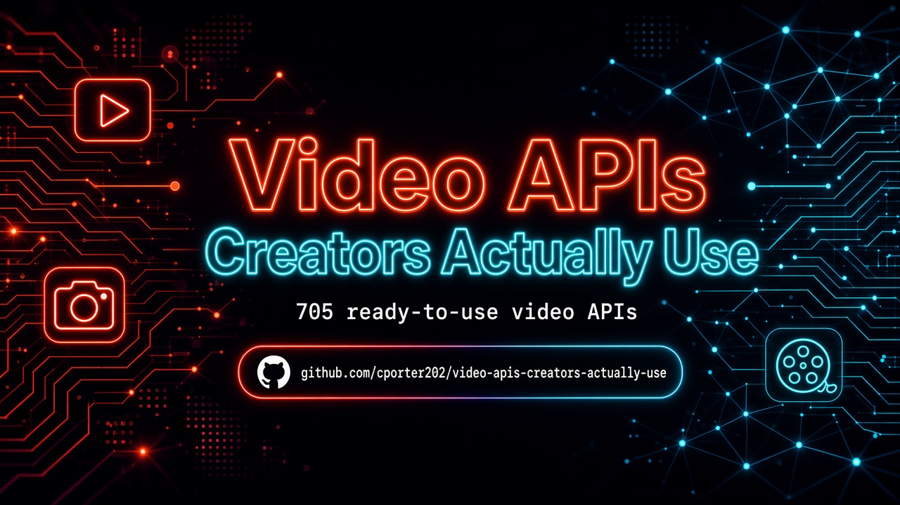

 
 

  <a href="#at-a-glance"><strong>At A Glance</strong></a>
  |
  <a href="#start-here"><strong>Start Here</strong></a>
  |
  <a href="#explore-the-stack"><strong>Explore The Stack</strong></a>
  |
  <a href="#why-this-repo-wins"><strong>Why This Repo Wins</strong></a>
  |
  <a href="#star-history"><strong>Star History</strong></a>

### 🚀 Join My Skool Community

**Want to learn how to vibe code like the pros? Join my Skool community! 🎯**

*I'll show you how to set up applications to use these APIs and start making money! I have the best tech stack when it comes to vibe coding that virtually costs nothing. Forget tools like Loveable, Replit, Manus, Base44, etc.*

 

  <a href="https://www.skool.com/vibe-coding-with-chris-7196" target="_blank" style="display: inline-block; background: #667eea; background-image: linear-gradient(135deg, #667eea 0%, #764ba2 100%); color: #ffffff !important; text-decoration: none !important; padding: 18px 45px; font-size: 18px; font-weight: bold; border-radius: 35px; box-shadow: 0 8px 25px rgba(102, 126, 234, 0.5); letter-spacing: 1px; text-transform: uppercase; border: 2px solid rgba(255, 255, 255, 0.3); cursor: pointer; font-family: -apple-system, BlinkMacSystemFont, 'Segoe UI', Helvetica, Arial, sans-serif;">
    🚀 Join Vibe Coding Community →
  </a>

<!-- APIMESA-FEATURED-START -->
## ⭐ Featured: APIMesa

  

**[APIMesa](https://apimesa.com)** is a pay-per-call API marketplace with 150+ live APIs for AI, scraping, data, SEO, lead generation, media, and developer utilities — one API key, clear per-call credit pricing, and a live playground for every API.

<!-- APIMESA-FEATURED-END -->

## At A Glance

> The ultimate collection of video APIs creators actually use — YouTube, Shorts, transcripts, thumbnails, and more. **705 production-ready APIs** across **5 navigable sections**.

This repository is designed to feel like a launchpad, not a junk drawer. Pick a section folder, scan the API table, and click through to the provider — no endless flat scrolling.

| Metric | Count |
|--------|-------|
| Total APIs | 705 |
| Categories | 5 |
| Last Updated | 2026-09-16 |
| Focus | Creator Video |

<table>
  <tr>
    <td width="33%" valign="top">
      <h3>YouTube Channel Tools</h3>
      
<strong>289 APIs</strong>

      
YouTube channel scrapers, analytics, search, and channel growth intel.

      
<a href="./youtube-channel-tools/"><strong>Open YouTube Channel Tools Directory</strong></a>

    </td>
    <td width="33%" valign="top">
      <h3>Transcripts & Captions</h3>
      
<strong>75 APIs</strong>

      
Transcript extractors, captions, subtitles, and speech-to-text for video.

      
<a href="./transcripts-captions/"><strong>Open Transcripts & Captions Directory</strong></a>

    </td>
    <td width="33%" valign="top">
      <h3>Shorts & Clips</h3>
      
<strong>153 APIs</strong>

      
YouTube Shorts, TikTok clips, Reels-style short video, and clip cutters.

      
<a href="./shorts-clips/"><strong>Open Shorts & Clips Directory</strong></a>

    </td>
  </tr>
  <tr>
    <td width="50%" valign="top">
      <h3>Thumbnails & Metadata</h3>
      
<strong>66 APIs</strong>

      
Thumbnail grabbers, video metadata, tags, and packaging helpers.

      
<a href="./thumbnails-metadata/"><strong>Open Thumbnails & Metadata Directory</strong></a>

    </td>
    <td width="50%" valign="top">
      <h3>Other Video Tools</h3>
      
<strong>122 APIs</strong>

      
Everything else video — Vimeo, Twitch, downloaders, and misc creator tooling.

      
<a href="./other-video-tools/"><strong>Open Other Video Tools Directory</strong></a>

    </td>
    <td width="50%"></td>
  </tr>
</table>

## Start Here

1. Pick the section you need first from the cards above.
2. Open that folder's README and scan the API names and descriptions.
3. Click through to the provider page for implementation details, pricing, and docs.
4. Build your shortlist fast instead of wasting hours digging through a flat list.

## Explore The Stack

<strong>YouTube Channel Tools</strong> (289)

YouTube channel scrapers, analytics, search, and channel growth intel.

- channel scrapers & analytics
- video search & metadata
- subscriber / view intel
- competitor channel research

[Browse YouTube Channel Tools APIs](./youtube-channel-tools/)

<strong>Transcripts & Captions</strong> (75)

Transcript extractors, captions, subtitles, and speech-to-text for video.

- transcript extractors
- captions / subtitles
- speech-to-text
- subtitle translation

[Browse Transcripts & Captions APIs](./transcripts-captions/)

<strong>Shorts & Clips</strong> (153)

YouTube Shorts, TikTok clips, Reels-style short video, and clip cutters.

- YouTube Shorts
- TikTok / short clips
- clip cutters & highlights
- short-form growth tools

[Browse Shorts & Clips APIs](./shorts-clips/)

<strong>Thumbnails & Metadata</strong> (66)

Thumbnail grabbers, video metadata, tags, and packaging helpers.

- thumbnail downloaders
- video metadata / tags
- title & description intel
- packaging helpers

[Browse Thumbnails & Metadata APIs](./thumbnails-metadata/)

<strong>Other Video Tools</strong> (122)

Everything else video — Vimeo, Twitch, downloaders, and misc creator tooling.

- Vimeo / Twitch / niche platforms
- downloaders & converters
- livestream tools
- misc creator video APIs

[Browse Other Video Tools APIs](./other-video-tools/)

## Built For

<table>
  <tr>
    <td width="25%" align="center"><strong>YouTubers</strong></td>
    <td width="25%" align="center"><strong>Short-Form Creators</strong></td>
    <td width="25%" align="center"><strong>Agencies</strong></td>
    <td width="25%" align="center"><strong>Course Creators</strong></td>
  </tr>
  <tr>
    <td width="25%" align="center"><strong>Podcast Clippers</strong></td>
    <td width="25%" align="center"><strong>Social Teams</strong></td>
    <td width="25%" align="center"><strong>Thumbnail Designers</strong></td>
    <td width="25%" align="center"><strong>UGC Marketers</strong></td>
  </tr>
</table>

## Why This Repo Wins

- It is opinionated. Sections map to how builders actually search for APIs.
- It is navigable. Top-level folders beat one giant markdown table every time.
- It is faster to use. Jump straight to the category that matches your use case.
- It keeps affiliate tracking intact (`?fpr=p2hrc6`) on every link.
- Custom PNG hero banner — crisp and launch-ready.

## Scope Guarantee

This repository intentionally organizes APIs into:

**YouTube Channel Tools**, **Transcripts & Captions**, **Shorts & Clips**, **Thumbnails & Metadata**, **Other Video Tools**

Unmatched rows land in the `other-*` catch-all so **zero APIs are dropped**.

## Follow the Creator

See [FOLLOW_CREATOR.md](./FOLLOW_CREATOR.md) — follow Chris Porter on Facebook for more valuable repos and updates.

## Star History

## Maintenance Notes

- Section classification is keyword-based on API name + description.
- Every original table row is preserved exactly, including affiliate params.
- Visual launchpad layout matches the style of [marketing-apis-that-drive-roi](https://github.com/cporter202/marketing-apis-that-drive-roi).

<!-- AIWITHCHRIS-BANNER-START -->

  

  <a href="https://aiwithchris.com"><strong>🚀 Join my AI Playbook — aiwithchris.com</strong></a> 
  $10/month · 3,600+ prompts · agent workflows · repo breakdowns · money ideas

<!-- AIWITHCHRIS-BANNER-END -->

